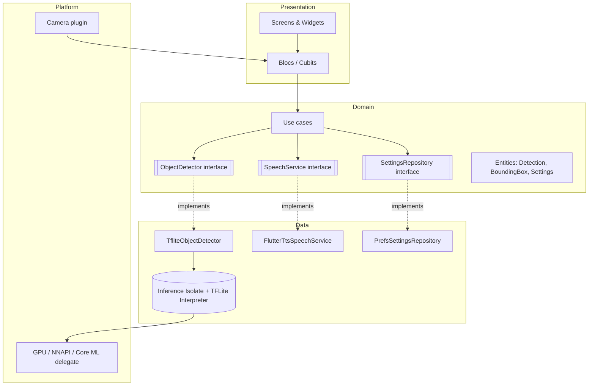
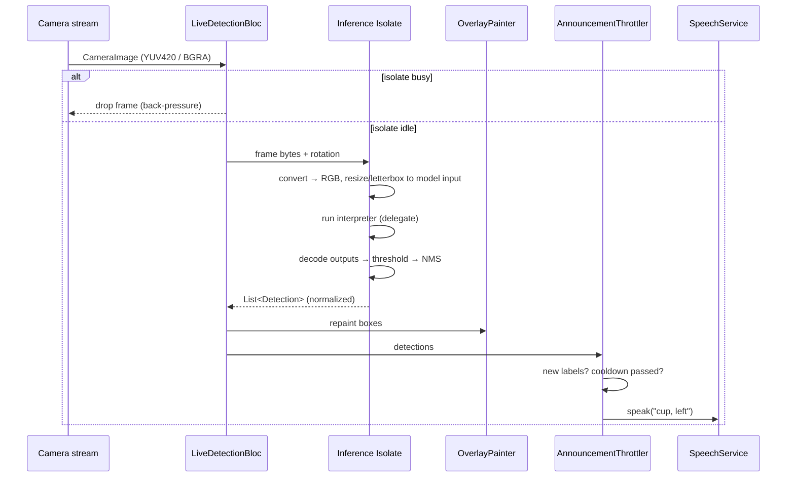
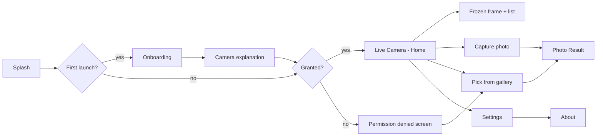

# Seevo — Software Design Document (SDD)

| Field | Value |
|---|---|
| Document | SDD (structure based on IEEE 1016) |
| Version | 0.1 (Draft) |
| Date | 2026-10-14 |
| Related | [01-project-charter.md](01-project-charter.md), [02-SRS.md](02-SRS.md) |

---

## 1. Design Overview
Seevo is a single Flutter app. It uses **Clean Architecture** and a **feature-first** folder layout. The camera, AI model, text-to-speech and storage are behind interfaces, so each layer can be tested on its own and the model can be swapped (NFR-M3). Object detection runs in a **background isolate** so the UI stays smooth (NFR-P5). There is no network layer (NFR-S1).

## 2. Technology Stack
| Concern | Choice | Reason |
|---|---|---|
| Framework | Flutter (stable), Dart 3 | One codebase for iOS and Android (NFR-M1) |
| State management | `flutter_bloc` + `equatable` (+ `get_it` for DI) | Explicit events → states; highly testable with `bloc_test`; traceable |
| Navigation | `go_router` | Declarative routes, deep-link ready |
| Camera | `camera` | Official plugin; image stream for frames |
| Gallery | `image_picker` | Official plugin; asks for permission only when used (FR-6.4) |
| Inference | `tflite_flutter` (+ `IsolateInterpreter`) | On-device TFLite with GPU / NNAPI / Core ML delegates |
| Image processing | `image` | Decode, resize, convert YUV/BGRA to RGB |
| TTS | `flutter_tts` | Uses the system TTS engines |
| Permissions | `permission_handler` | Unified permission flow |
| Storage | `shared_preferences` | Small settings store |
| Localization | `flutter_localizations` + ARB / `intl` | Ready for more languages, including right-to-left |
| Haptics | `HapticFeedback` (Flutter services) | Built in, no extra dependency |
| Lint | `flutter_lints` (strict) | Code quality (NFR-M4) |
| Testing | `flutter_test`, `integration_test`, `mocktail` | Unit, widget and integration tests |

## 3. Architecture

### 3.1 Layer diagram


Dependencies point inward: the presentation layer depends on the domain layer, and the data layer implements the domain interfaces. The domain layer has no Flutter or plugin imports.

### 3.2 Folder structure
```
seevo/
├─ lib/
│  ├─ main.dart
│  ├─ app.dart                    # MaterialApp.router, themes, l10n
│  ├─ core/
│  │  ├─ theme/                   # light, dark, high-contrast tokens
│  │  ├─ router/                  # go_router config
│  │  ├─ l10n/                    # ARB files
│  │  ├─ utils/                   # image conversion, geometry
│  │  └─ errors/
│  └─ features/
│     ├─ detection/
│     │  ├─ domain/               # Detection, BoundingBox, ObjectDetector, NMS
│     │  ├─ data/                 # TfliteObjectDetector, isolate worker, label loader
│     │  └─ presentation/         # LiveCameraScreen, DetectionOverlayPainter, bloc/
│     ├─ gallery/                 # PhotoResultScreen, PhotoDetectionBloc
│     ├─ speech/                  # SpeechService, AnnouncementThrottler, PositionCue
│     ├─ settings/                # Settings entity, repository, SettingsScreen
│     └─ onboarding/              # Onboarding pages, permission gate
├─ assets/
│  └─ models/                     # detector.tflite, labels.txt
├─ test/                          # unit + widget tests (mirrors lib/)
├─ integration_test/              # on-device end-to-end tests + sample images
└─ docs/
```

## 4. Key Domain Model
```dart
class BoundingBox { final double left, top, right, bottom; } // normalized 0..1
class Detection   { final String label; final double confidence; final BoundingBox box; }

abstract interface class ObjectDetector {
  Future<void> load(DetectorConfig config);           // model path, threads, delegate
  Future<List<Detection>> detect(InputImageData img);  // RGB bytes + w/h + rotation
  Future<void> dispose();
}

abstract interface class SpeechService {
  Future<void> speak(String text, {bool interrupt = false});
  Future<void> stop();
  Future<void> configure({double rate, double pitch, String locale});
}
```
Boxes are stored as **normalized coordinates** (0–1). The UI layer maps them to screen pixels, which keeps the model separate from the screen layout (FR-1.4).

## 5. Detection Pipeline

### 5.1 Live detection sequence


### 5.2 Pipeline details
1. **Frame throttling:** frames that arrive while the isolate is busy are dropped. Performance mode sets the minimum interval between frames: Battery saver about 5 FPS, Balanced up to 15 FPS, Max accuracy unlimited.
2. **Pre-processing:**
   - Convert YUV420 (Android) or BGRA8888 (iOS) to RGB.
   - Rotate according to the sensor orientation.
   - Letterbox-resize to the model input size (e.g. 320×320 or 448×448) and keep the scale/padding values so boxes can be mapped back.
3. **Inference:** use `IsolateInterpreter` with a delegate:
   - iOS: Metal GPU (Core ML as an option)
   - Android: GPU delegate, falling back to XNNPACK on the CPU
   - If no delegate is available, use 2–4 CPU threads.
4. **Post-processing:**
   - Drop results below the confidence threshold (FR-5.1).
   - Per-class NMS with IoU 0.5.
   - Keep the top N results.
   - Convert to normalized boxes.
5. **Smoothing (Should):** a light IoU-based tracker keeps labels stable between frames, which reduces flicker and repeated announcements.

### 5.3 Photo detection
Uses the same `ObjectDetector`. The photo is decoded and its EXIF orientation is applied, then it runs through the same pre-processing and inference. The result screen draws the boxes over the image, shown with `BoxFit.contain`.

## 6. Speech & Accessibility Design
- **AnnouncementThrottler** (pure Dart, unit-tested):
  - Keeps a `Map<label, lastSpokenAt>`.
  - Speaks a label only if it is new in view or its cooldown (default 3 s) has passed.
  - Sorts by confidence and area, then caps at "max objects announced".
  - Groups duplicates ("two chairs").
- **PositionCue:** uses the box centre-x. The left third gives "left", the middle "ahead", the right third "right". Optionally, boxes covering more than 40% of the frame add "close".
- **Screen reader coexistence (FR-3.5):**
  - Check `MediaQuery.accessibleNavigation`.
  - When a screen reader is active, send announcements through `SemanticsService.announce` so they queue with VoiceOver/TalkBack instead of talking over them.
  - Otherwise use `flutter_tts`.
- **Semantics:**
  - Every control is wrapped in `Semantics` with a label and hint.
  - The detection overlay is excluded from semantics; the list of detections is exposed instead.
- **Themes:**
  - Light, dark and high-contrast.
  - Contrast of at least 4.5:1, minimum tap target 48 dp.
  - Text scales with the system font size (NFR-A1/A2).

## 7. UI / Screen Flow
> **Figma design (source of truth for UI):** https://www.figma.com/design/utmKz4eciRFdDTsix2opPS — pages: Cover, Design System (tokens: Light / Dark / High Contrast), Components, Screens (13 screens, light + dark), User Flow.



**Live Camera (home) layout:**
```
┌───────────────────────────┐
│ [⚙ Settings]   [🔦 Torch] │
│                           │
│     camera preview        │
│   ┌──────┐                │
│   │ cup  │ 92%            │
│   └──────┘                │
│                           │
│ [🖼 Gallery] [⏸/📷] [🔊 On]│  ← large, labeled buttons
└───────────────────────────┘
```

## 8. State Management (Bloc)
> **Decision (2026-10-14, owner):** `flutter_bloc`. Every state change is an explicit, loggable event, which helps traceability (FR → event → state → test). Riverpod was considered as a lighter-weight alternative.

**Packages:** `flutter_bloc`, `bloc`, `equatable` (value equality for states and events), `bloc_test` (tests), `get_it` (wiring the repositories and services injected into blocs).

| Bloc / Cubit | Key events | State | Responsibility |
|---|---|---|---|
| `SettingsCubit` | `load()`, `update(Settings)` | `SettingsState` | Load and persist settings (FR-5) |
| `ModelLoaderCubit` | `load()` | `initial / loading / ready(detector) / failure` | Load the YOLO model once at splash |
| `LiveDetectionBloc` | `CameraStarted`, `FrameReceived`, `FreezeToggled`, `TorchToggled`, `AppPaused`, `AppResumed`, `DetectionSelected` | `LiveDetectionState` (status, detections, fps, frozen, selected) | Camera lifecycle, frame loop with back-pressure, freeze & inspect (FR-1, FR-7, NFR-R2) |
| `PhotoDetectionBloc` | `PhotoPicked`, `PhotoCaptured`, `SpeakAllRequested` | `initial / analysing / success(detections) / empty / failure` | Detection on one image (FR-2) |
| `SpeechCubit` | `announce(detections)`, `toggleVoice()` | `SpeechState` (enabled, lastSpoken) | Uses `AnnouncementThrottler` + `SpeechService` (FR-3, FR-4) |
| `OnboardingCubit` / `PermissionCubit` | `next()`, `requestCamera()` | step / permission status | Onboarding and permission flow (FR-6) |

- **High-frequency frames:** `FrameReceived` uses the `droppable()` transformer from `bloc_concurrency`. Frames that arrive while inference is busy are dropped (back-pressure, NFR-P5).
- **App lifecycle:** an `AppLifecycleListener` dispatches `AppPaused` / `AppResumed`. The camera is released on pause and re-initialised on resume (NFR-R2).
- **Logging:** a global `BlocObserver` logs events and transitions in debug builds, which gives an audit trail for testing.

## 9. Model Selection Plan (decision gate for M2)
| Candidate | Licence | Classes | Expected speed | Notes |
|---|---|---|---|---|
| **EfficientDet-Lite0 / Lite2** (TFLite) | Apache-2.0 ✅ | COCO 80 | Lite0 fast, Lite2 more accurate | Includes metadata and NMS post-processing; ready for TFLite |
| **SSD MobileNet V2 / V3** | Apache-2.0 ✅ | COCO 80 | Very fast | Lower accuracy on small objects |
| **YOLO11n / YOLOv8n** (exported to TFLite) | AGPL-3.0 ⚠️ | COCO 80 | Fast, best accuracy for its size | Commercial closed-source use needs an Ultralytics licence |

**Benchmark procedure:**
1. Integrate the detector behind `ObjectDetector`.
2. Run each candidate model on the reference devices (iPhone 11, Pixel 6a) plus one low-end Android phone. Record:
   - FPS and p50/p95 latency
   - Memory use
   - App size added
   - Precision/recall on a 100-image labelled test set
3. Pick the model with the best accuracy that meets NFR-P1, P2 and M2 and passes the licence check.

**Decision (2026-10-14, owner): Ultralytics YOLO (YOLO11n, exported to TFLite, float16/int8). Accepted AGPL-3.0 for now; must open-source the app or buy an Ultralytics Enterprise licence before any closed-source commercial release. EfficientDet-Lite2 stays the fallback, and swapping is cheap because of the `ObjectDetector` interface.**

## 10. Error Handling
| Situation | Behaviour |
|---|---|
| Model fails to load | Error screen with retry; log it; gallery and live features disabled |
| Camera unavailable or in use | Message plus retry; gallery still works |
| Permission denied or permanently denied | Explanation plus "Open Settings" (FR-6.3) |
| TTS engine missing | Fall back to visual only; show a one-time notice |
| Inference error on one frame | Skip the frame silently; if errors repeat, show a banner |

## 11. Security & Privacy Design
- No network permission in use and no HTTP client dependency (Android `INTERNET` permission removed in release builds where possible).
- Frames are processed in memory only; nothing is written to disk except a captured photo while it is being viewed.
- Platform permission strings:
  - iOS `NSCameraUsageDescription`: "Seevo uses the camera to recognise objects around you. Images never leave your device."
  - iOS `NSPhotoLibraryUsageDescription`: "Seevo analyses photos you choose, on your device only."

## 12. Testing Hooks (for Phase 5)
- Domain logic is pure Dart (NMS, letterbox mapping, throttler, position cue), so it can be unit-tested.
- `ObjectDetector` can be mocked (`FakeObjectDetector`) for widget tests.
- `integration_test/` bundles sample images with expected labels to check the real model on devices.
- A debug overlay shows FPS, latency and the delegate in use, for benchmarking.

## 13. Approval
| Name | Role | Decision | Date |
|---|---|---|---|
| Eslam Madhoun | Project Owner | ☐ Approved ☐ Changes requested | |
